<p align="center">
  <a href="https://knowbuddy.xyz">
    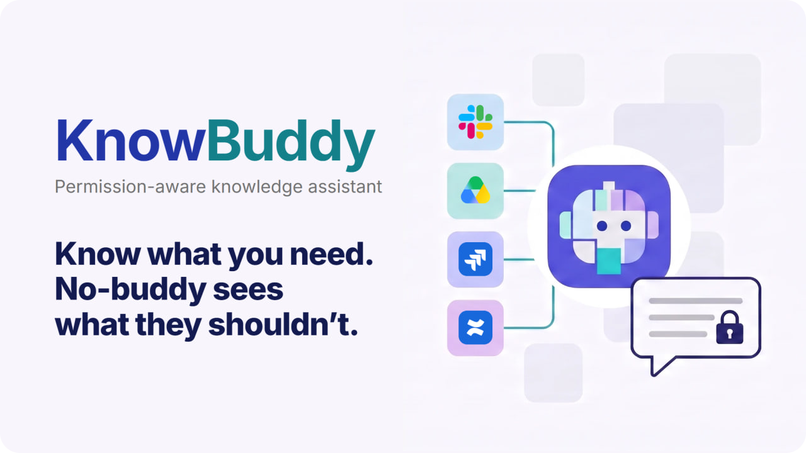
  </a>
</p>

<h1 align="center">KnowBuddy</h1>

<p align="center">
  <strong>Ask your company's tools a question. See only what you're allowed to.</strong><br>
  <sub>Know what you need. No-buddy sees what they shouldn't.</sub>
</p>

<p align="center">
  <a href="https://knowbuddy.xyz"></a>
  
  
</p>

<p align="center">
  
  
  
  
  
</p>

<p align="center">
  <a href="#how-it-works">How it works</a> ·
  <a href="#features">Features</a> ·
  <a href="#architecture">Architecture</a> ·
  <a href="#security-guarantees">Security</a> ·
  <a href="#try-it">Try it</a> ·
  <a href="#documentation">Docs</a>
</p>

<p align="center">
  English · <a href="README.zh-CN.md">中文</a>
</p>

---

KnowBuddy answers questions from a company's **Slack, Google Drive, Jira and Confluence** in one place, with
citations, using only what the person asking can already see in those tools. Every question and every admin action
goes into a tamper-evident audit log.

<p align="center">
  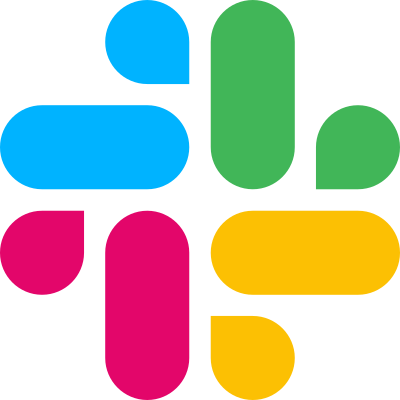&nbsp;&nbsp;&nbsp;&nbsp;
  &nbsp;&nbsp;&nbsp;&nbsp;
  &nbsp;&nbsp;&nbsp;&nbsp;
  
</p>

Built for the **Tencent Cloud AI CAN DO IT Hackathon Singapore 2026**, FinTech track, answering Aspire's challenge
*"The Internal Brain: a context-aware enterprise knowledge system with RBAC, security logging and an audit trail"*.

## Why it exists

- **Knowledge is scattered.** In the challenge's Company A, with 12,000+ Confluence pages, 30+ Jira projects and 200+
  Slack channels, employees lose about 30% of their week searching for information.
- **Every tool has its own permissions.** Confluence page restrictions, Jira issue security, Slack private channels
  and Drive sharing don't fit into one role list. Flattening them breaks access control.
- **An assistant that can read everything can leak everything.** In a regulated FinTech, a leak through an AI answer
  is still a data breach.
- **Permissions change all the time**, so permissions copied when content was indexed go stale.
- **Auditors need to reconstruct what an AI showed to whom.** Most assistants keep no per-document record.

**KnowBuddy turns four searches into one question, without widening anyone's access.**

## How it works

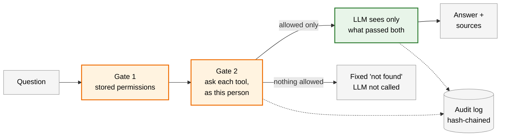

1. **Gate 1: stored permissions.** One SQL query searches only the asker's company, inside the admin's boundary,
   where a document's permission list shares one of the asker's identities. Keyword (BM25) and meaning (pgvector)
   results are merged by rank, and the filter runs inside that same query.
2. **Gate 2: live check.** Each remaining document is re-checked with its own tool, *as the asker*, in parallel. A
   "no", an error or a 2-second timeout drops it, so a revoked permission applies on the very next question.
3. **Grounded answer.** The allowed sources are masked for personal data, fenced as untrusted text and sent to `hy3`.
   Code then removes any citation or link to something the model wasn't sent. If nothing passed, the reply is a fixed
   "not found" that looks the same whether or not a restricted document exists.

<details>
<summary><strong>One question, step by step</strong> (sequence diagram)</summary>

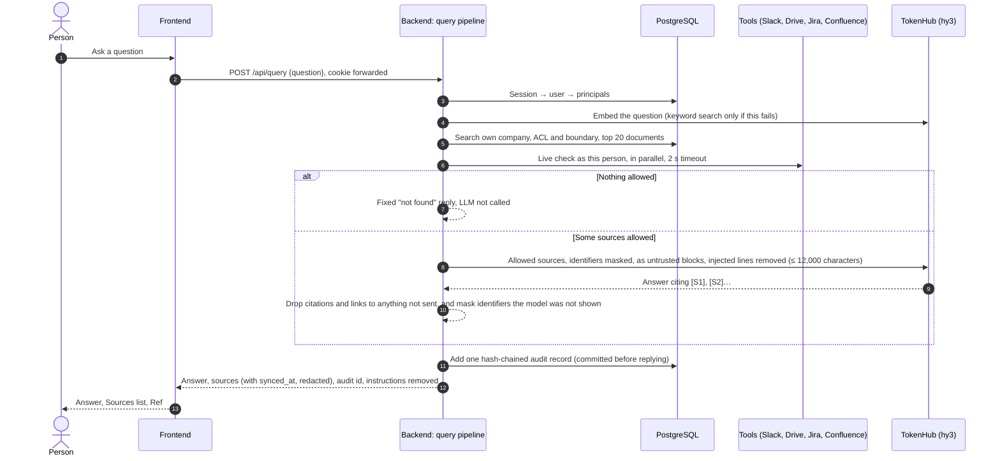

Every field and step: [QUERY_PIPELINE.md](docs/architecture/QUERY_PIPELINE.md).

</details>

## See it in action

<h3 align="center">1 · Connect your tools</h3>
<p align="center">Sign in with the tools you already use. KnowBuddy reads them as you, so answers only include what you can already see.</p>
<p align="center">
  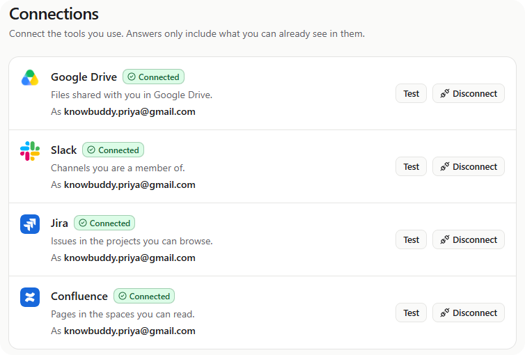
</p>
<br>

<h3 align="center">2 · Ask a question</h3>
<p align="center">Get one answer that cites its sources and says when each was last synced.</p>
<p align="center">
  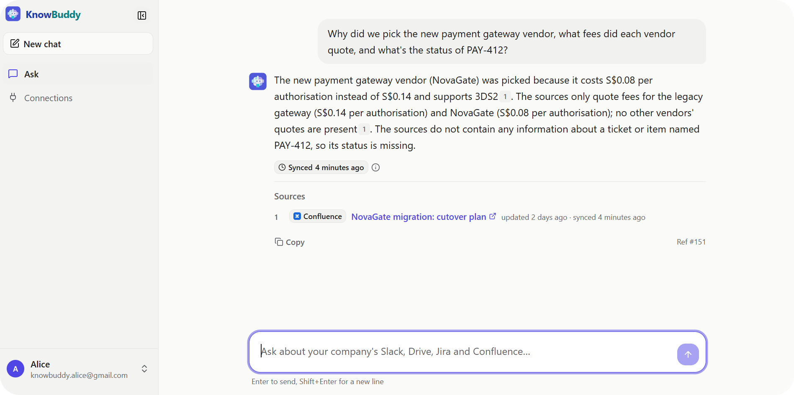
</p>
<br>

<h3 align="center">3 · Ask the audit trail</h3>
<p align="center">Admins ask who accessed what in plain language, or filter by person and date.</p>
<p align="center">
  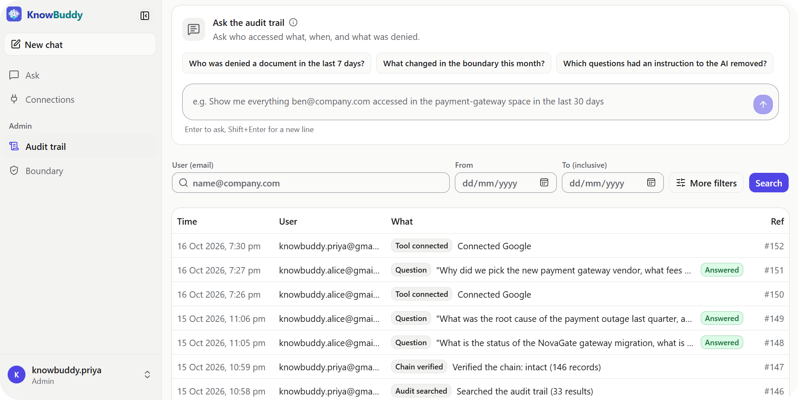
</p>
<br>

<h3 align="center">4 · Open any record</h3>
<p align="center">Who asked, how long each step took, and every document's decision and reason.</p>
<p align="center">
  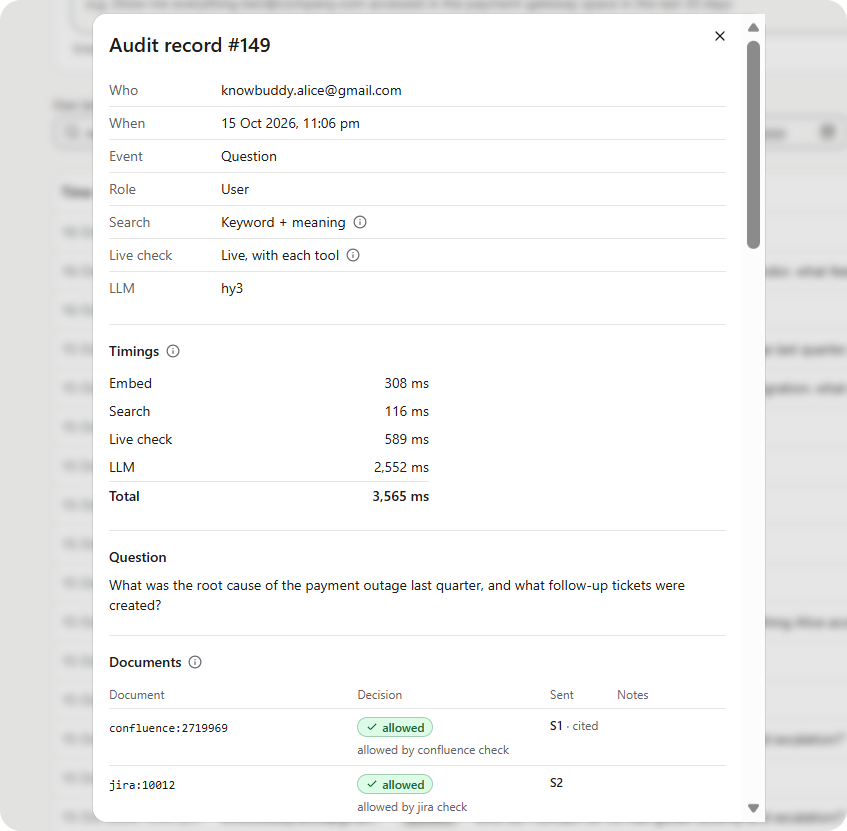
</p>

## The five challenge scenarios

Each is worked through with real output in [FEATURES.md](docs/FEATURES.md).

| # | Scenario | Status |
|:-:|---|:-:|
| 1 | [One answer from several tools, with citations](docs/FEATURES.md#scenario-1-one-answer-from-several-tools-with-citations) | ✅ |
| 2 | [Fresh within a stated window](docs/FEATURES.md#scenario-2-fresh-within-a-stated-window): about 5 minutes, or at once with "sync now" | ✅ |
| 3 | [A restricted document stays invisible](docs/FEATURES.md#scenario-3-a-restricted-document-stays-invisible), and its existence isn't revealed | ✅ |
| 4 | [A revoked permission applies at once](docs/FEATURES.md#scenario-4-a-revoked-permission-applies-at-once), on the very next question | ✅ |
| 5 | [An admin reconstructs what someone accessed](docs/FEATURES.md#scenario-5-what-did-this-person-access), from a tamper-evident log | ✅ |

## Features

<table>
  <tr>
    <td width="33%" valign="top">
      <h4>🔐 Two permission gates</h4>
      Stored permissions filter the search, then each tool confirms access live, as the asker. On doubt, the answer is no.
      <br><a href="docs/ARCHITECTURE.md#2-the-trust-boundary">Trust boundary →</a>
    </td>
    <td width="33%" valign="top">
      <h4>🔑 Sign in with your tools</h4>
      No passwords. Signing in with Slack, Google or Atlassian proves who you are and connects that tool in one step.
      <br><a href="docs/FEATURES.md#signing-in-by-connecting-your-tools">Sign-in →</a>
    </td>
    <td width="33%" valign="top">
      <h4>🧭 The admin's boundary</h4>
      The admin ticks which channels, folders, projects and spaces KnowBuddy may read. Everything else is never synced.
      <br><a href="docs/FEATURES.md#the-admins-boundary">Boundary →</a>
    </td>
  </tr>
  <tr>
    <td valign="top">
      <h4>⚡ Always fresh</h4>
      Content syncs every 5 minutes, or at once with "sync now". Each source shows when it was last synced.
      <br><a href="docs/FEATURES.md#scenario-2-fresh-within-a-stated-window">Freshness →</a>
    </td>
    <td valign="top">
      <h4>🛡️ Need-to-Know Shield</h4>
      Cards, NRIC/FIN, bank accounts, phones and names are masked before the AI sees them, except for the people handling that item.
      <br><a href="docs/FEATURES.md#need-to-know-shield-personal-data-only-for-the-people-handling-it">Shield →</a>
    </td>
    <td valign="top">
      <h4>🧱 Prompt-injection defence</h4>
      Retrieved text is fenced as data. Lines aimed at the AI are removed and recorded, and unseen links are stripped.
      <br><a href="docs/FEATURES.md#grounded-answers-and-retrieved-text-kept-in-its-place">Grounding →</a>
    </td>
  </tr>
  <tr>
    <td valign="top">
      <h4>📜 Tamper-evident audit log</h4>
      Every question records each candidate document, its decision and its reason. Records are hash-chained and append-only.
      <br><a href="docs/FEATURES.md#scenario-5-what-did-this-person-access">Audit →</a>
    </td>
    <td valign="top">
      <h4>💬 Audit assistant</h4>
      Admins ask the audit trail in plain language. Code runs and counts the search; the AI only summarises the records it cites.
      <br><a href="docs/ARCHITECTURE.md#2-the-trust-boundary">How it's fenced →</a>
    </td>
    <td valign="top">
      <h4>🏢 Company isolation</h4>
      Many companies share one deployment. Every search, sync and audit query is limited to one company.
      <br><a href="docs/ARCHITECTURE.md#5-signing-in-and-companies">Companies →</a>
    </td>
  </tr>
</table>

## Architecture

One Docker Compose stack, locally and on one Tencent Cloud Lighthouse server: `db`, `backend`, `sync` and `frontend`
keep running, `migrate` sets up the tables and exits, and production adds a Caddy `proxy` for HTTPS.

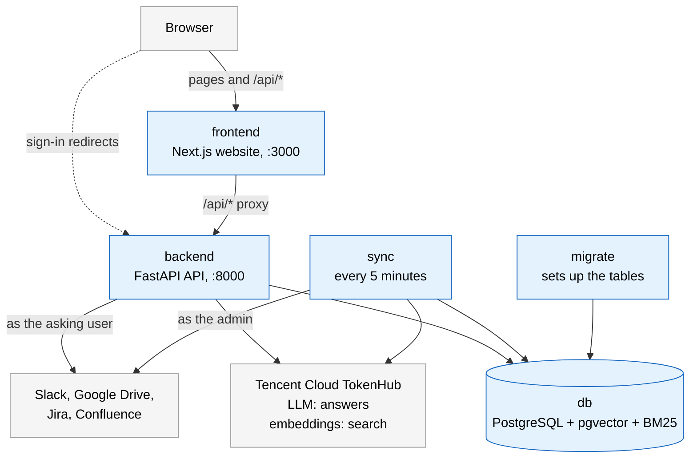

| Part | Built with | Why it exists |
|---|---|---|
| Website | Next.js, Tailwind, shadcn/ui | Sign in, connect tools, ask questions and, as admin, set the boundary and review the audit log |
| API | FastAPI (Python) | Signs people in, enforces permissions, runs the question pipeline, writes the audit log |
| Sync worker | Python, same code as the API | Copies each company's chosen content and its permissions every 5 minutes, so search is fast |
| Database | PostgreSQL with pgvector and ParadeDB `pg_search` | Documents, permissions, search indexes and the audit log in one place, kept consistent by transactions |
| LLM and embeddings | Tencent Cloud TokenHub (`hy3`, `kinfra-text-embedding-0.6b`) | Writes answers from allowed sources, and turns text into vectors for search by meaning |
| Hosting | Docker Compose and Caddy on Tencent Cloud Lighthouse | One server with HTTPS; every merge to `main` deploys itself after CI passes |

The trust boundary, sign-in, sync, the data model and the trade-offs: [ARCHITECTURE.md](docs/ARCHITECTURE.md).
Why each choice was made: [DECISIONS.md](docs/decisions/DECISIONS.md).

## By the numbers

<table align="center">
  <tr>
    <td align="center"><h3>280 ms</h3><sub>median permission-filtered<br>search, 100,000 pieces</sub></td>
    <td align="center"><h3>373 ms</h3><sub>the same search,<br>95th percentile</sub></td>
    <td align="center"><h3>~5 min</h3><sub>content freshness,<br>or at once with "sync now"</sub></td>
    <td align="center"><h3>~330 MB</h3><sub>memory for the five<br>live containers</sub></td>
    <td align="center"><h3>799</h3><sub>automated tests<br>on every pull request</sub></td>
  </tr>
</table>

<p align="center"><sub>Search: load test on a laptop, for an employee who may see 42% of the pieces (12 Oct, <a href="docs/TESTING.md#9-search-at-scale">TESTING.md §9</a>). Memory: <code>docker stats</code> on the 2 vCPU, 2 GB server (11 Oct, before the database moved to the ParadeDB image). Tests: 600 backend, 199 frontend.</sub></p>

## Security guarantees

- **The LLM never decides access.** Permissions are enforced in code, before the model is called.
- **Fail closed.** A tool that says no, errors or times out drops the document.
- **No existence leaks.** "Not found" reads the same whether or not a restricted document exists.
- **Retrieved text is data, never instructions.** Sources are fenced, and lines addressed to the AI are removed.
- **An audit log that can't be quietly edited.** Records are hash-chained per company, and the app's database login
  can only add them.

Each rule, the threat model and the test that guards it: [SECURITY.md](docs/SECURITY.md).

## Try it

**Live:** <https://knowbuddy.xyz>. Sign in with Slack, Google or Atlassian. For now, Google sign-in is in testing
mode (listed test users only), and only the Atlassian app's owner can connect Jira and Confluence
([DEPLOYMENT.md](docs/DEPLOYMENT.md)).

**On your computer**, with Git and Docker Desktop:

```bash
git clone https://github.com/gabriel-wan/tencent-hackathon-fintech.git && cd tencent-hackathon-fintech
cp backend/.env.example backend/.env && cp frontend/.env.example frontend/.env
```

Set the four settings in [RUNNING.md](docs/RUNNING.md) §2 (two database passwords, an encryption key and your
TokenHub key), then start the stack and load the demo companies:

```bash
docker compose up --build
docker compose run --rm backend python -m app.seed   # in a second terminal
```

✅ http://localhost:3000/status shows "Database ok".

Open http://localhost:3000/login and sign in as one of the seeded users. Then try:

- **A cited answer:** ask a question that spans several tools, and see one answer with its sources.
- **A restricted document:** ask as a user without access, and get "not found", with no hint that it exists.
- **Company isolation:** ask the same question from another company, and get only that company's answer.
- **The audit trail:** as the admin, open **Audit trail**, inspect each document's decision and verify the chain.

The seeded users, questions to ask and connecting your own tools: [RUNNING.md](docs/RUNNING.md) §4–5.

## Project layout

```
backend/     FastAPI API and sync worker: app/, tests/, migrations/
frontend/    Next.js website
docs/        guides, architecture, decisions and hackathon material
deploy/      the production Caddyfile
scripts/     helper scripts (check_doc_links.py)
```

The full map and a glossary: [docs/README.md](docs/README.md).

## Documentation

| Guide | Read it to |
|---|---|
| [RUNNING.md](docs/RUNNING.md) | Run and use KnowBuddy, with demo personas or your own tools |
| [FEATURES.md](docs/FEATURES.md) | See each feature and scenario working, and how it works |
| [ARCHITECTURE.md](docs/ARCHITECTURE.md) | See how it's built: the trust boundary, the parts, the data model, the trade-offs |
| [SECURITY.md](docs/SECURITY.md) | Know the security rules and the tests that guard them |
| [TESTING.md](docs/TESTING.md) | Test a change, or check everything before submitting |
| [DEPLOYMENT.md](docs/DEPLOYMENT.md) | Put it on a server |
| [PROJECT.md](docs/PROJECT.md) | Know the goals, scope, roadmap and open questions |
| [CONTRIBUTING.md](CONTRIBUTING.md) | Change code, open a pull request, or propose a decision |

## Built on Tencent Cloud

| | Used for |
|---|---|
| **TokenHub** | `hy3` writes every answer; `kinfra-text-embedding-0.6b` powers search by meaning |
| **Lighthouse** | The one server that runs the whole stack, with Caddy for HTTPS |
| **CodeBuddy** | Security reviews and the trust-boundary diagram during development ([evidence](docs/hackathon/tool-usage.md)) |
| **Miora** | The cover image |

<details>
<summary><strong>Evidence:</strong> the live server and TokenHub usage</summary>
<br>
<p align="center">
  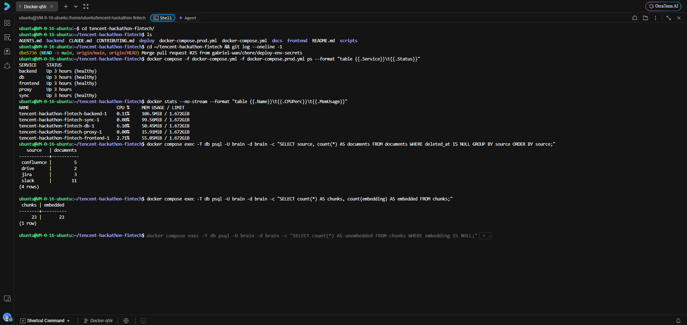
  <br><br>
  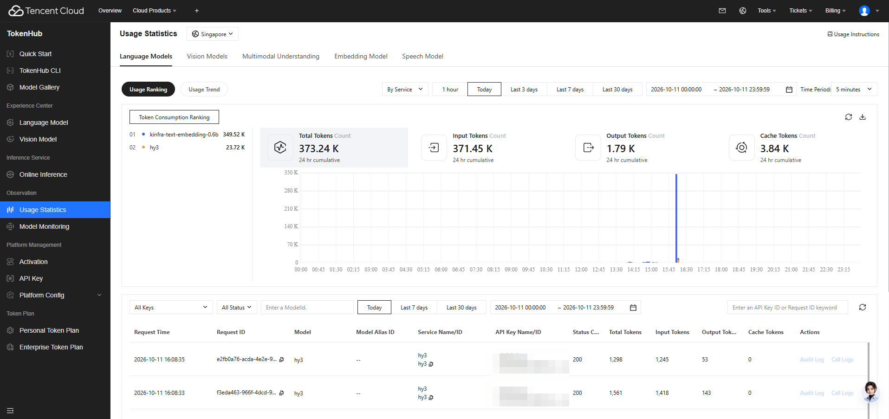
</p>
</details>

---

<p align="center">
  <sub>Built in Singapore for the Tencent Cloud AI CAN DO IT Hackathon 2026 · FinTech track · <a href="LICENSE">MIT License</a></sub><br>
  <sub>Slack, Google Drive, Jira and Confluence names and logos are trademarks of their owners and are not covered by the licence.</sub>
</p>
