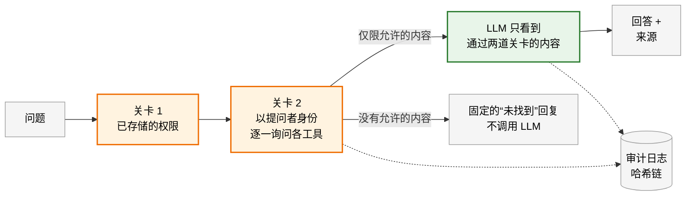
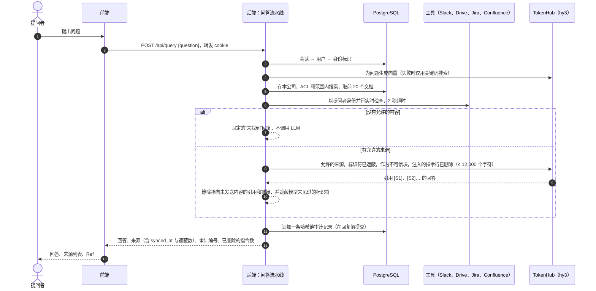
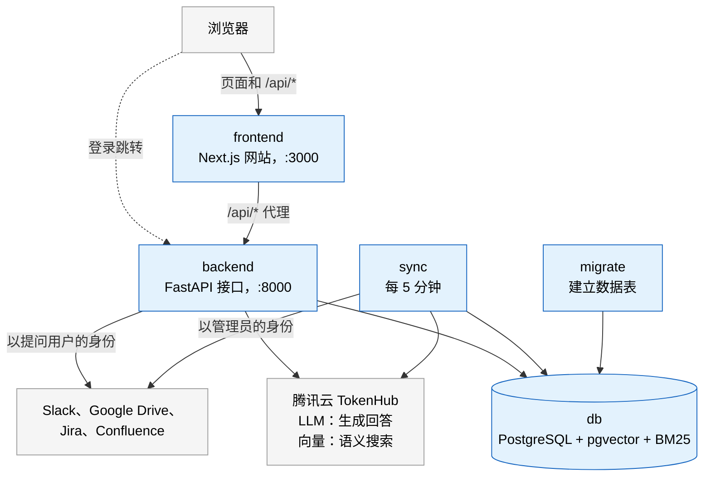

<p align="center">
  <a href="https://knowbuddy.xyz">
    
  </a>
</p>

<h1 align="center">KnowBuddy</h1>

<p align="center">
  <strong>向公司的各个工具提问，只看到你有权看到的内容。</strong><br>
  <sub>知你所需，越权内容谁也看不到。</sub>
</p>

<p align="center">
  <a href="https://knowbuddy.xyz"></a>
  
  
</p>

<p align="center">
  
  
  
  
  
</p>

<p align="center">
  <a href="#工作原理">工作原理</a> ·
  <a href="#功能">功能</a> ·
  <a href="#架构">架构</a> ·
  <a href="#安全保证">安全</a> ·
  <a href="#立即试用">试用</a> ·
  <a href="#文档">文档</a>
</p>

<p align="center">
  <a href="README.md">English</a> · 中文
</p>

---

KnowBuddy 在一个地方回答来自公司 **Slack、Google Drive、Jira 和 Confluence** 的问题，并附上引用来源，且只使用提问者在这些工具中本来就能看到的内容。每一次提问和每一项管理员操作，都会写入可检测篡改的审计日志。

<p align="center">
  &nbsp;&nbsp;&nbsp;&nbsp;
  &nbsp;&nbsp;&nbsp;&nbsp;
  &nbsp;&nbsp;&nbsp;&nbsp;
  
</p>

本项目为 **腾讯云 AI CAN DO IT 黑客松（新加坡，2026）** 金融科技赛道而作，回应 Aspire 的赛题
*“The Internal Brain：具备 RBAC、安全日志与审计追踪的上下文感知企业知识系统”*。

> 本页链接的详细指南（`docs/` 下的文档）均为英文。

## 为什么需要它

- **知识分散各处。** 在赛题中的 A 公司，有 12,000 多个 Confluence 页面、30 多个 Jira 项目和 200 多个 Slack
  频道，员工每周约 30% 的时间花在查找信息上。
- **每个工具都有自己的权限模型。** Confluence 的页面限制、Jira 的问题安全级别、Slack 的私有频道和 Drive 的共享设置，
  无法归并成一张角色表。强行拍平，就破坏了访问控制。
- **能读取一切的助手，也能泄露一切。** 在受监管的金融科技公司，通过 AI 回答泄露的数据同样是数据泄露。
- **权限一直在变化**，因此在建立索引时复制下来的权限会过时。
- **审计人员需要还原 AI 向谁展示了什么。** 大多数助手不保留逐个文档的记录。

**KnowBuddy 把四次搜索变成一个问题，而且不扩大任何人的访问权限。**

## 工作原理



1. **关卡 1：已存储的权限。** 一条 SQL 查询只在提问者所在的公司、管理员划定的范围之内搜索，且只匹配权限列表中包含
   提问者某个身份的文档。关键词（BM25）与语义（pgvector）结果按排名合并，权限过滤就在同一条查询中执行。
2. **关卡 2：实时检查。** 剩下的每个文档都会*以提问者的身份*，向其所属工具并行再确认一次。只要工具回答“否”、出错
   或超过 2 秒未响应，该文档就会被剔除，因此撤销的权限在下一个问题中立即生效。
3. **有据可依的回答。** 允许的来源先遮蔽个人数据，再作为不可信文本隔离包裹，发送给 `hy3`。随后由代码删除任何指向
   未发送给模型的内容的引用或链接。如果没有任何内容通过，回复就是固定的“未找到”，无论受限文档是否存在，看起来都一样。

<details>
<summary><strong>一个问题的完整流程</strong>（时序图）</summary>



每个字段和步骤：[QUERY_PIPELINE.md](docs/architecture/QUERY_PIPELINE.md)。

</details>

## 实际效果

<h3 align="center">1 · 连接你的工具</h3>
<p align="center">用你已经在用的工具登录。KnowBuddy 以你的身份读取它们，所以回答只包含你本来就能看到的内容。</p>
<p align="center">
  
</p>
<br>

<h3 align="center">2 · 提出问题</h3>
<p align="center">得到一个附带引用来源的回答，并显示每个来源上次同步的时间。</p>
<p align="center">
  
</p>
<br>

<h3 align="center">3 · 查询审计记录</h3>
<p align="center">管理员可以用自然语言询问谁访问了什么，也可以按人员和日期筛选。</p>
<p align="center">
  
</p>
<br>

<h3 align="center">4 · 打开任意一条记录</h3>
<p align="center">谁提的问、每一步耗时多久，以及每个文档的判定结果和原因。</p>
<p align="center">
  
</p>

## 赛题的五个场景

每个场景都在 [FEATURES.md](docs/FEATURES.md) 中用真实输出完整演示。

| # | 场景 | 状态 |
|:-:|---|:-:|
| 1 | [一个回答汇集多个工具，并附引用](docs/FEATURES.md#scenario-1-one-answer-from-several-tools-with-citations) | ✅ |
| 2 | [在约定时间窗口内保持最新](docs/FEATURES.md#scenario-2-fresh-within-a-stated-window)：约 5 分钟，或点“立即同步”马上更新 | ✅ |
| 3 | [受限文档保持不可见](docs/FEATURES.md#scenario-3-a-restricted-document-stays-invisible)，且不暴露其存在 | ✅ |
| 4 | [撤销的权限立即生效](docs/FEATURES.md#scenario-4-a-revoked-permission-applies-at-once)，在下一个问题中就生效 | ✅ |
| 5 | [管理员还原某人访问过的内容](docs/FEATURES.md#scenario-5-what-did-this-person-access)，依据可检测篡改的日志 | ✅ |

## 功能

<table>
  <tr>
    <td width="33%" valign="top">
      <h4>🔐 两道权限关卡</h4>
      先用已存储的权限过滤搜索结果，再由每个工具以提问者身份实时确认访问权限。有疑问时，一律拒绝。
      <br><a href="docs/ARCHITECTURE.md#2-the-trust-boundary">信任边界 →</a>
    </td>
    <td width="33%" valign="top">
      <h4>🔑 用你的工具登录</h4>
      无需密码。用 Slack、Google 或 Atlassian 登录，既能证明你的身份，也一步完成该工具的连接。
      <br><a href="docs/FEATURES.md#signing-in-by-connecting-your-tools">登录 →</a>
    </td>
    <td width="33%" valign="top">
      <h4>🧭 管理员划定的范围</h4>
      管理员勾选 KnowBuddy 可以读取的频道、文件夹、项目和空间。其余内容一律不会同步。
      <br><a href="docs/FEATURES.md#the-admins-boundary">范围 →</a>
    </td>
  </tr>
  <tr>
    <td valign="top">
      <h4>⚡ 始终最新</h4>
      内容每 5 分钟同步一次，也可以点“立即同步”马上更新。每个来源都会显示上次同步的时间。
      <br><a href="docs/FEATURES.md#scenario-2-fresh-within-a-stated-window">时效性 →</a>
    </td>
    <td valign="top">
      <h4>🛡️ 按需知密保护（Need-to-Know Shield）</h4>
      银行卡号、NRIC/FIN、银行账户、电话和姓名在 AI 看到之前就被遮蔽，只有负责该事项的人才能看到原文。
      <br><a href="docs/FEATURES.md#need-to-know-shield-personal-data-only-for-the-people-handling-it">保护 →</a>
    </td>
    <td valign="top">
      <h4>🧱 防御提示词注入</h4>
      检索到的文本被当作数据隔离包裹。针对 AI 的指令行会被删除并记录，模型未见过的链接也会被移除。
      <br><a href="docs/FEATURES.md#grounded-answers-and-retrieved-text-kept-in-its-place">有据可依 →</a>
    </td>
  </tr>
  <tr>
    <td valign="top">
      <h4>📜 可检测篡改的审计日志</h4>
      每个问题都会记录每个候选文档、对它的判定和原因。记录采用哈希链，只能追加。
      <br><a href="docs/FEATURES.md#scenario-5-what-did-this-person-access">审计 →</a>
    </td>
    <td valign="top">
      <h4>💬 审计助手</h4>
      管理员用自然语言查询审计记录。搜索与计数由代码执行，AI 只负责总结它引用的记录。
      <br><a href="docs/ARCHITECTURE.md#2-the-trust-boundary">如何隔离 →</a>
    </td>
    <td valign="top">
      <h4>🏢 公司间隔离</h4>
      多家公司共用一套部署。每一次搜索、同步和审计查询都只限于一家公司。
      <br><a href="docs/ARCHITECTURE.md#5-signing-in-and-companies">公司 →</a>
    </td>
  </tr>
</table>

## 架构

本地和一台腾讯云轻量应用服务器（Lighthouse）上运行同一套 Docker Compose：`db`、`backend`、`sync` 和 `frontend`
持续运行，`migrate` 建好数据表后退出，生产环境另加一个 Caddy `proxy` 提供 HTTPS。



| 组成部分 | 技术 | 为什么需要它 |
|---|---|---|
| 网站 | Next.js、Tailwind、shadcn/ui | 登录、连接工具、提问；管理员还可设置范围、查看审计日志 |
| 接口 | FastAPI（Python） | 处理登录、执行权限控制、运行问答流水线、写入审计日志 |
| 同步进程 | Python，与接口共用代码 | 每 5 分钟复制每家公司选定的内容及其权限，让搜索更快 |
| 数据库 | PostgreSQL，搭配 pgvector 和 ParadeDB `pg_search` | 文档、权限、搜索索引和审计日志集中一处，由事务保证一致 |
| LLM 与向量 | 腾讯云 TokenHub（`hy3`、`kinfra-text-embedding-0.6b`） | 根据允许的来源撰写回答，并把文本转为向量以支持语义搜索 |
| 托管 | 腾讯云 Lighthouse 上的 Docker Compose 和 Caddy | 一台服务器，启用 HTTPS；每次合并到 `main` 并通过 CI 后自动部署 |

信任边界、登录、同步、数据模型和取舍：[ARCHITECTURE.md](docs/ARCHITECTURE.md)。
每项选择的理由：[DECISIONS.md](docs/decisions/DECISIONS.md)。

## 关键数据

<table align="center">
  <tr>
    <td align="center"><h3>280 ms</h3><sub>权限过滤搜索的中位耗时<br>10 万个文本片段</sub></td>
    <td align="center"><h3>373 ms</h3><sub>同一搜索的<br>第 95 百分位耗时</sub></td>
    <td align="center"><h3>约 5 分钟</h3><sub>内容时效，<br>或点“立即同步”马上更新</sub></td>
    <td align="center"><h3>约 330 MB</h3><sub>线上五个容器的<br>内存占用</sub></td>
    <td align="center"><h3>799</h3><sub>每个拉取请求<br>都运行的自动化测试</sub></td>
  </tr>
</table>

<p align="center"><sub>搜索：在笔记本电脑上做的负载测试，测试对象是可查看 42% 片段的普通员工（10 月 12 日，<a href="docs/TESTING.md#9-search-at-scale">TESTING.md §9</a>）。内存：在 2 vCPU、2 GB 服务器上用 <code>docker stats</code> 测得（10 月 11 日，数据库换用 ParadeDB 镜像之前）。测试：后端 600 个，前端 199 个。</sub></p>

## 安全保证

- **LLM 从不决定访问权限。** 权限在调用模型之前由代码执行。
- **出错即拒绝。** 工具回答“否”、出错或超时，文档都会被剔除。
- **不泄露存在性。** 无论受限文档是否存在，“未找到”的回复都完全相同。
- **检索到的文本是数据，绝不是指令。** 来源被隔离包裹，针对 AI 的指令行会被删除。
- **无法被悄悄修改的审计日志。** 记录按公司组成哈希链，应用的数据库账号只能追加记录。

每条规则、威胁模型以及守护它的测试：[SECURITY.md](docs/SECURITY.md)。

## 立即试用

**在线体验：**<https://knowbuddy.xyz>。用 Slack、Google 或 Atlassian 登录。目前 Google 登录处于测试模式（仅限列入名单的
测试用户），且只有 Atlassian 应用的所有者可以连接 Jira 和 Confluence（[DEPLOYMENT.md](docs/DEPLOYMENT.md)）。

**在你的电脑上运行**，需要 Git 和 Docker Desktop：

```bash
git clone https://github.com/gabriel-wan/tencent-hackathon-fintech.git && cd tencent-hackathon-fintech
cp backend/.env.example backend/.env && cp frontend/.env.example frontend/.env
```

按 [RUNNING.md](docs/RUNNING.md) §2 设置四项配置（两个数据库密码、一个加密密钥和你的 TokenHub 密钥），然后启动服务并载入
演示公司的数据：

```bash
docker compose up --build
docker compose run --rm backend python -m app.seed   # 在第二个终端中运行
```

✅ http://localhost:3000/status 显示 “Database ok”。

打开 http://localhost:3000/login，以任意一个预置用户登录，然后试试：

- **附引用的回答：** 问一个跨多个工具的问题，得到一个列出来源的回答。
- **受限文档：** 以无权访问的用户提问，得到“未找到”，看不出该文档存在。
- **公司间隔离：** 从另一家公司问同一个问题，只得到那家公司自己的回答。
- **审计记录：** 以管理员身份打开 **Audit trail**，查看每个文档的判定结果并校验哈希链。

预置用户、可以问的问题，以及如何连接你自己的工具：[RUNNING.md](docs/RUNNING.md) §4–5。

## 项目结构

```
backend/     FastAPI 接口和同步进程：app/、tests/、migrations/
frontend/    Next.js 网站
docs/        指南、架构、决策记录和黑客松材料
deploy/      生产环境的 Caddyfile
scripts/     辅助脚本（check_doc_links.py）
```

完整目录和术语表：[docs/README.md](docs/README.md)。

## 文档

| 指南 | 用途 |
|---|---|
| [RUNNING.md](docs/RUNNING.md) | 运行和使用 KnowBuddy，可用演示用户或你自己的工具 |
| [FEATURES.md](docs/FEATURES.md) | 查看每个功能和场景的实际效果及其原理 |
| [ARCHITECTURE.md](docs/ARCHITECTURE.md) | 了解系统如何构建：信任边界、组成部分、数据模型和取舍 |
| [SECURITY.md](docs/SECURITY.md) | 了解安全规则以及守护它们的测试 |
| [TESTING.md](docs/TESTING.md) | 测试改动，或在提交前做全面检查 |
| [DEPLOYMENT.md](docs/DEPLOYMENT.md) | 部署到服务器 |
| [PROJECT.md](docs/PROJECT.md) | 了解目标、范围、路线图和待定问题 |
| [CONTRIBUTING.md](CONTRIBUTING.md) | 修改代码、提交拉取请求或提出决策 |

## 基于腾讯云构建

| | 用途 |
|---|---|
| **TokenHub** | `hy3` 撰写每一个回答；`kinfra-text-embedding-0.6b` 支持语义搜索 |
| **Lighthouse** | 运行整套服务的那台服务器，由 Caddy 提供 HTTPS |
| **CodeBuddy** | 开发期间的安全审查和信任边界图（[使用证明](docs/hackathon/tool-usage.md)） |
| **Miora** | 封面图 |

<details>
<summary><strong>证明材料：</strong>线上服务器和 TokenHub 用量</summary>
<br>
<p align="center">
  
  <br><br>
  
</p>
</details>

---

<p align="center">
  <sub>为腾讯云 AI CAN DO IT 黑客松 2026 而作，诞生于新加坡 · 金融科技赛道 · <a href="LICENSE">MIT 许可证</a></sub><br>
  <sub>Slack、Google Drive、Jira 和 Confluence 的名称与标志是其各自所有者的商标，不在本许可证范围内。</sub>
</p>
