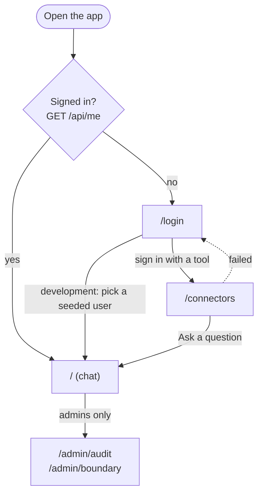

# The frontend

**For:** anyone changing pages, or wanting to know how the website talks to the backend and keeps people's data safe.
**You'll:** see every page, how sign-in and the session gate work, how answers are shown, and the design and
accessibility rules.
**Not here:** commands, folders and styling conventions → [frontend/README.md](../../frontend/README.md) ·
checking it by hand → [TESTING.md](../TESTING.md) · the backend → [ARCHITECTURE.md](../ARCHITECTURE.md).

The frontend never decides who may see what: the backend filters by permission before anything reaches the LLM
([SECURITY.md](../SECURITY.md), INV-2). File paths below are relative to `frontend/`. The decisions behind this design
are ADR-009 in [DECISIONS.md](../decisions/DECISIONS.md).

**Contents:** Pages · Sign-in · Chat · Admin pages · Talking to the backend · Design principles · Accessibility

## Pages

| Route | What it shows |
|---|---|
| `/` | Signed in only. The chat (see below) |
| `/login` | Sign-in: "Sign in with Slack" first, Google and Atlassian as logo buttons (links to the backend's OAuth), a collapsed "How accounts work"; development sign-in box and Slack token form when the backend is in development mode |
| `/connectors` | Signed in only (it checks its own session, see Connections). Connect, test and disconnect Google Drive, Slack, Jira and Confluence. The page the OAuth callback returns to |
| `/admin/audit` | Admins only. Search the audit trail, read each record, verify the hash chain (see "Admin pages") |
| `/admin/boundary` | Admins only. Choose which channels, folders, projects and spaces KnowBuddy may read; sync now (see "Admin pages") |
| `/status` | The backend's `/health` (database, pgvector), fetched server-side from `BACKEND_SERVER_URL`. For developers |
| `/healthz` | `200 ok` without calling the backend. Used by the Docker health check |
| `/api/*` | Not a page: forwards to the backend (see below) |

### Page map



Every OAuth sign-in returns to `/connectors` (the backend fixes that target),
so a successful sign-in lands there, with an "Ask a question" link to the chat. Non-admins who open an admin page are sent back to the chat, and **Sign out** (in the account menu)
returns to `/login`.

## Sign-in

There is no app login form and no password (ADR-002): signing in means
connecting a tool, handled by the backend's OAuth (`backend/app/connectors`).
The first connection creates your user and session. **Your company comes from
a Slack workspace**, never from Google or Atlassian: the first full member (not
a guest) to sign in from a new workspace creates the company and becomes its
admin. An Atlassian sign-in only joins a company whose admin has added that
site, and a user with only Google has no company and sees nothing.

- **Session gate.** `app/(app)/layout.tsx` calls `GET /api/me` on the server
  for every signed-in page. 401 → `/login`. Backend unreachable → "Can't reach
  the server" (not a redirect, which would look like being signed out). The
  user is passed to client components through `MeProvider` (`useMe()`), for
  display only. This gate is UX: the backend checks the session on every call.
- **`/login`.** Signed-in visitors go to `/`. The logo, a headline and, on
  wider screens, a decorative answer card (`components/login/hero-illustration.tsx`,
  made-up content, hidden from screen readers). "Sign in with Slack" is the main
  button because Slack is the only sign-in that can start a company; Google and
  Atlassian follow as logo-only buttons ("Alternatively, sign in with"), each
  with an accessible name and a tooltip on hover and keyboard focus. "How
  accounts work" is a native `<details>`, collapsed by default. All three are
  plain links to `${BACKEND_LOCAL_URL}/connectors/{slack,drive,jira}/connect`: a
  full-page navigation, never a `fetch`, because the OAuth redirect has to start
  and end on the backend. If a provider is not configured the backend answers
  503 and names the missing variable.
- **Errors.** The backend's OAuth callback redirects to
  `/connectors?connected=<provider>` or `/connectors?error=<code>` (the target
  is fixed in the backend). Only the codes in `lib/connectors.ts`
  (`access_denied`, `provider_error`, `invalid_state`, `account_mismatch`,
  `no_company`, `missing_permission`) have a message; any other value shows
  nothing, so a crafted link cannot put its own text on a page. A failed
  sign-in has no session, so `/connectors` carries a known error on to
  `/login?error=<code>`, where the person is trying to sign in.
- **Pages that read the session must render per request.** Call
  `await connection()` first, and start every server-side `catch` with
  `unstable_rethrow(error)`. Next.js signals "this page is dynamic" and
  `redirect()` by throwing; catching those by mistake made a production build
  bake the signed-in page as a fixed "Can't reach the server" page.
- **Sign out.** User menu → `DELETE /api/session` → full page load to
  `/login`. If the request fails, the menu says so and the user stays signed in.

### Connections (`/connectors`)

`app/connectors/page.tsx`, `components/connectors/`. One list, a row per tool:
its logo and name, a status chip (green "Connected", or "Not connected"), what
KnowBuddy reads there and the connected account, then **Connect** (a link to
the backend), or **Test** and **Disconnect**, on the right.

- **Own session check, not the `(app)` layout.** The layout would send a
  signed-out visitor to `/login` and lose the `?error=` code. The page shares
  the frame (`components/signed-in-shell.tsx`) with the layout.
- **Test and Disconnect are server actions** (`app/connectors/actions.ts`).
  They call `GET /connectors/{id}/ping` and `DELETE /connectors/{id}`, which sit
  outside `/api`, through `backendFetch()` in `lib/api/server.ts`, forwarding the
  visitor's cookie. Server actions are public endpoints, so the connector id is
  checked against the fixed list first (`isConnectorId`). Jira and Confluence
  share one Atlassian sign-in: disconnecting either removes both.
- **Company hint.** A user with connections but none of Slack, Jira or
  Confluence is told to connect one to join their company. (`/api/me` does not
  say whether you have a company; a field for it is on the wish list.)
- **Slack token form, development only.** Slack's OAuth needs https, so while the
  backend runs with `APP_ENV=development` a labelled form connects Slack with a
  pasted user token (`POST /api/dev/connectors/slack`). The form appears only
  when the backend lists `/api/dev/users`; there is no frontend `APP_ENV`.

### Development sign-in (persona switcher)

DEVELOPMENT ONLY, and labelled as such on screen. Identity is not verified.

- Shown only when the backend lists `GET /api/dev/users`, which exists only with
  `APP_ENV=development` in `backend/.env`. There is no frontend flag: with
  `APP_ENV=production` the routes return 404 and every development control
  disappears (checked).
- `/login` lists the seeded users (`docker compose run --rm backend python -m app.seed`);
  names come from the backend, none are hard-coded. They belong to fictional
  companies (MerlionPay, and Dana in Kopi Labs, to show company isolation).
  Personas have no real connection, so in development their questions use the
  stored-permission check instead of asking Slack or Drive live.
- Signed-in pages show an amber "Development tools" strip with the current user
  and a **Switch user** menu.
- Signing in or switching does a **full page load**, so nothing from the
  previous person (such as chat history) survives (SECURITY.md T6).

## Chat (`/`)

Code: `components/chat/`. **Empty chat:** the icon, "Good morning / afternoon /
evening, <first name>" (the viewer's own clock, so it appears once the page is
in the browser), what KnowBuddy does, the question box in the middle and the
example questions under it; the first question moves the box to the bottom.
**New chat** in the sidebar empties the thread. Each question is answered on its own: the backend
receives only `{question}`, never earlier questions or answers, so a follow-up
such as "what about last week?" has no context. History exists only in the
browser's memory for this page load (never `localStorage`) and is wiped by the
full page load on sign-out or user switch (SECURITY.md T6).

| State | When | What the user sees |
|---|---|---|
| Pending | Request in flight (about 3–5 s with the real LLM since hy3's hidden reasoning was turned off) | "Searching your sources…" with a skeleton. No invented progress steps |
| Answered | 200, not a fixed sentence | Beside the KnowBuddy icon, no card. Answer as plain text, each `[S<n>]` marker a small numbered chip (matched by the citation's `label`, numbered by its place in the Sources list) that scrolls to that source, highlights it for a moment and moves focus to its link; hover shows the title; a **trust line** of chips, each with an ⓘ: "N masked for you" (all sources' `redacted`, merged) and "Synced …" from the oldest source (red "May be out of date" after 15 minutes; nothing for data that never synced; `lib/citations.ts` `answerSummary`); numbered Sources list, each with the tool's logo and name, "N masked" when the Shield masked something for this reader (`redacted`, ADR-010; the kinds on hover and for screen readers), "updated …" and "synced …" (red with "may be out of date" after 15 minutes; nothing for data that never synced); **Copy** (the answer text; "Couldn't copy" if the browser refuses or doesn't reply within 1.5 s); `Ref #<audit_id>`, a link to `/admin/audit?record=N` for admins |
| Not found | 200, the fixed "I could not find this…" sentence | Muted text beside the icon, and Ref #. **Identical whether nothing exists or nothing is permitted** (INV-5): no trust line, whatever the response says |
| Unavailable | 200, the fixed "The assistant is unavailable…" sentence | Warning with Try again |
| Failed | 422, 503, other 5xx, backend unreachable | Short message with Try again (re-sends the same question in place) |
| Signed out | 401 | Full page load to `/login`; the draft is not kept |

Rules:
- **Answers are plain text**, never HTML: they come from untrusted retrieved
  content.
- **Only absolute `http(s)` source URLs become links**, in a new tab with
  `noopener noreferrer`; anything else is shown as plain text.
- **Example questions are generic.** They are shown to every user, so naming
  a real document would reveal that it exists (INV-5).
- One question at a time; the box stays editable while an answer is pending.
  Enter sends, Shift+Enter adds a line, and Enter is ignored while an input
  method (Chinese, Japanese, ...) is composing.
- Screen readers hear only the newest result (one polite live region). Focus
  returns to the question box after each answer. The thread follows new
  answers unless the reader has scrolled up.

### Checking the chat by hand

The persona-by-persona checks with expected answers, and the states that can only be triggered in mock mode:
[docs/TESTING.md](../TESTING.md) sections 4 and 6.

## The frame (sidebar)

`components/signed-in-shell.tsx`, `app-sidebar.tsx`, `main-nav.tsx`,
`user-menu.tsx`. Every signed-in page has a left sidebar: the logo and a
collapse button, **New chat**, the links (Ask, Connections; for admins an
"Admin" group with Audit trail and Boundary), and at the bottom the account
menu (name and email, theme, Sign out).

- **Collapsed** to icons (each with its name as label and tooltip) by the
  button at the top; remembered in the `kb_sidebar` cookie, read on the server
  so the first paint is right (`lib/sidebar.ts`).
- **Below 768 px** a slim top bar with a menu button opens the same contents
  in a sheet from the left.
- **New chat** gives the chat page a fresh, empty thread
  (`components/chat-session.tsx`); the thread was only ever in memory.
- The development strip stays full width above everything, sticky on
  desktop. The public pages (sign-in, status) keep the slim top bar.

## Admin pages

`app/(app)/admin/`. ADR-007: one admin role, which also does compliance.

- **Gate.** `app/(app)/admin/layout.tsx` sends non-admins back to the chat;
  the sidebar shows Ask and Connections for everyone and an "Admin" group
  (Audit trail, Boundary) for admins. Both are UX only: every admin API
  route checks `is_admin` itself and returns 403.
- **Audit trail** (`/admin/audit`, `components/admin/audit-trail.tsx`). Calls
  `GET /api/admin/audit` and `POST /api/admin/audit/verify`
  (`backend/app/audit/api.py`) through the `/api` proxy.
  - **Filter bar:** user, from and to (whole days in the viewer's time zone;
    "to" is inclusive) in view; event type, tool (+ channel, folder, project or
    space ID) and document behind **More filters** (a popover; its button
    counts how many are set). Searching is explicit (Search or Enter), since
    every search is recorded. Applied filters show as removable chips with
    **Clear filters** (`filterChips`, `withoutFilter` in `lib/audit.ts`;
    removing the tool also removes its scope). They are kept in the URL
    (`/admin/audit?user=…&from=…`), so a view can be bookmarked or shared.
  - **Table:** one row per record, newest first, 50 at a time with **Load
    older** (`before_id`), fixed columns so long lines truncate. "What" is the
    event as a chip, then the question in quotes (or the one-line `summarise`
    for other events), then for questions their outcome chips (`outcomes`):
    Answered (green), Not found, LLM failed (red) and "N denied" (red: denied
    by the live check or restricted matches). The whole row opens the record.
  - **Empty:** "No records yet", or with filters "No records match these
    filters" with Clear filters.
  - **Record dialog** (`components/admin/audit-record.tsx`): a centred dialog,
    titled "Audit record #N". The open record is in the URL (`?record=56`), so
    it can be linked or bookmarked, Back closes it, and Escape returns focus to
    its row. A record of another company is refused ("isn't in your company's
    trail"). Explanations sit behind ⓘ buttons, not in headings. For a question:
    - a **Details** table: who, when, event, role, search ("Keyword +
      meaning"), live check ("Live, with each tool", or "Stored permissions
      (development only)" for a seeded persona, AGENTS.md §2.5; the table row
      also ends "· not live-checked") and LLM;
    - a **Timings** table, one row per step, total in bold;
    - the **Question** and **Answer**, with an ⓘ only when they hold masked
      values (`hasMaskedValues`), and quiet lines for an instruction attempt
      in the question, links removed or invented citations removed;
    - one **Documents** table (`documentRows`): each document the question
      matched, with its decision (green ✓ allowed, red ✗ denied, the words
      kept) and reason, sent as S1, S2… (stored in label order) and cited,
      and notes: values masked for this person (Need-to-Know Shield), "shown
      in full" for a handler, instructions removed (ADR-011). Restricted
      matches are its denied rows. On a phone it scrolls sideways inside its
      box.

    Other events: the Details table with their own fields. Every record: its
    hash and the previous one, and the raw JSON.
  - **ⓘ** (`components/info-tip.tsx`, Radix Popover): opens on hover, keyboard
    focus and tap; Escape closes it without closing the dialog. Screen readers
    get the text as the button's description.
  - **One search, one request:** in development React runs effects twice on
    mount; the page reuses the request for each search, so a visit writes one
    `audit_searched` record, as in production.
  - **Hash chain card** at the top: "Not verified on this visit", then a green
    "Intact" chip with the number checked (the latest record's hash and **Copy
    hash** in a collapsed section, to note it outside KnowBuddy, ADR-007), or a
    red "Broken at #N" with the reason and **Open record #N**.
  - The API declares no response model, so the types are written by hand in
    `lib/audit.ts`; keep them in step with the payloads the backend writes.
    Every search and verification is itself recorded in the trail.
- **Boundary** (`/admin/boundary`, `components/admin/boundary-editor.tsx`).
  Calls the admin API in `backend/app/connectors/admin.py`:
  `GET /api/admin/scopes/{source}` (what the admin can see in each tool, read
  with their own connection), `GET /api/admin/boundary`, `PUT` and `DELETE
  /api/admin/boundary/{source}/{scope_id}`, `POST
  /api/admin/boundary/{source}/bulk` and `POST /api/admin/sync`. Built for
  hundreds of channels and nested folders (the handbook's Company A).
  - **A sticky bar** (from 768 px; on phones it scrolls away) stays in view while scrolling: one search across the four
    tools ("Find a channel, folder, project or space", matching names and
    Drive paths, the match highlighted), **Show** All / In the boundary / Not
    in it (`matchRows` in `lib/boundary.ts`), Sync now and the sync status.
  - **One collapsible section per tool** (Slack, Google Drive, Jira,
    Confluence), each loading its own list, so one tool failing never blanks
    the others; the heading says "4 of 73 channels in the boundary · 10
    shown". The first 50 rows, then "Show 100 more".
  - **Per tool:** Slack in Public and Private groups (a lock on private ones;
    DMs are never offered). Drive as a **tree** (`treeOrder`), or with each
    folder's path when searching; a folder under a ticked one is shown ticked
    and locked, "Included with *Parent*" (`coveredBy`), since sync includes
    subfolders and the backend refuses overlapping folders (409, shown under
    the row). Jira with the project key.
  - **Bulk:** "Add all N shown" and "Remove all N shown" per section, on what
    the search and Show leave (`bulkRows`: adding skips folders already
    included, folders with one below them in, and folders under another being
    added). Over 50 (`BULK_LIMIT`) they are disabled with "Search to narrow
    it". A confirmation names the first five, says what happens, and how many
    are private channels; one request, all or nothing, each scope audited on
    its own; adding starts a sync, like a tick.
  - **A checkbox per scope.** Ticking adds it and starts a sync at once.
    Unticking asks first ("its content stops appearing in answers immediately,
    for everyone"; for a scope that never synced, e.g. seeded demo data: "only
    re-seeding brings it back").
  - **Each allowed scope's status:** "Synced 3 minutes ago"; "Not synced yet";
    "Last synced 40 minutes ago: it may be failing" after 15 minutes (three
    missed syncs; the backend records only successful ones); "Can't sync until
    Slack is connected (again)" when its tool isn't connected or refused the
    stored access; or "You can no longer see this channel" when it's no longer
    in the admin's own list.
  - **Sync now** syncs the whole company. The sync runs in the background, so
    the page polls `GET /api/admin/boundary` every 3 s for up to a minute, until
    every allowed scope that *can* sync has a new `last_synced_at` (compared
    with the server's own times, not the browser clock), then says "Synced just
    now" or lists what didn't sync. Scopes that can't sync (`blockedReason` in
    `lib/boundary.ts`: tool not connected, refused, or scope no longer visible)
    are not waited for; if none can sync, it says so at once without calling
    the backend.
  - **A tool's own errors are not ours:** for the scope list, the backend's 404
    "connect … first" means not connected, 401 "… connect again" the tool
    refused the stored access, and 502 "… API call failed" the tool's API
    failed. `listScopes` recognises only those messages (`scopesProblem`), so a
    revoked Slack token shows "Connect it again" instead of signing the admin
    out; anything unrecognised fails safe as an ordinary error (a 401 means
    sign in again).
  - "How the boundary works" explains the two checks (the tool's permission
    and the boundary) in plain words, with links to boundary additions and
    removals in the audit trail.
- Documents are shown by key (`drive:D_Q3_INCIDENT`), not title, until the
  team decides whether the admin may see titles of documents they cannot
  read (an open question, listed in [PROJECT.md](../PROJECT.md) "Open items").

## Talking to the backend

```
browser ──/api/*──▶ frontend proxy (app/api/[...path]/route.ts) ──▶ BACKEND_SERVER_URL/api/*
server components ──lib/api/server.ts──▶ BACKEND_SERVER_URL/api/*  (forwards the request's Cookie header)
```

- **The browser only talks to the frontend's origin.** The `/api/*` route
  handler forwards each request to `BACKEND_SERVER_URL`, so the backend's httpOnly
  `ib_session` cookie is set for this origin and no CORS setup is needed.
  It is a route handler, not a `next.config.ts` rewrite: a test build showed
  rewrites capture `BACKEND_SERVER_URL` at build time, while Docker sets it at run time.
- **The proxy decides nothing.** It forwards only `content-type`, `accept` and
  `cookie`, cannot leave `/api`, takes its host only from `BACKEND_SERVER_URL`,
  passes every `Set-Cookie` back, and never retries. Backend unreachable:
  `502`; slower than 30 s: `504`.
- **Never call `fetch` for the backend directly.** Client components use
  `lib/api/client.ts`; server components and layouts use `lib/api/server.ts`.
  Both throw `NotSignedInError` (401), `BackendUnreachableError` (network,
  502, 504) or `ApiError` (`lib/api/errors.ts`).
- **No function takes a user ID.** Who is asking comes only from the session
  cookie (SECURITY.md INV-3). `askQuestion` sends exactly `{question}`.
- **Development mode comes from the backend:** `listDevUsers()` on the server
  returns `null` when `/api/dev/users` does not exist (backend not in
  `APP_ENV=development`), and every development-only control is hidden.

### API types

`lib/api/schema.d.ts` is generated from the backend's `/openapi.json`; never
edit it by hand. With the backend running locally in development mode (so the
dev routes are included), from `frontend/`:

```
npm run gen:api-types
```

Rerun it whenever a backend route or response changes, and commit the result.
`lib/api/types.ts` gives the generated types friendly names.

### Answers, citations and links

- `lib/answers.ts`: the backend's two fixed replies, copied exactly, and
  `classifyAnswer()` (`answered` / `notFound` / `unavailable`). The only file
  to change if the backend wording changes.
- `lib/citations.ts`: `splitAnswer()` turns the answer into text and numbered
  source markers by each citation's `label` (unknown labels dropped, the rest
  stays text); `stripCitationMarkers()` removes them (for Copy); `safeHttpUrl()` returns a URL only if
  it is absolute `http(s)`. Answer text and source URLs are untrusted: render
  answers as plain text and link only what `safeHttpUrl` accepts.
- `lib/format.ts`: relative and exact timestamps, in the viewer's locale
  (client components only).

### Mock mode (development only)

`NEXT_PUBLIC_API_MOCK=1` fakes `askQuestion` (`POST /api/query`) with labelled fixtures from `lib/api/mock.ts`, so
the chat states can be built without spending LLM tokens. It is ignored in production builds. How to use it:
[docs/TESTING.md](../TESTING.md) section 6.

## Design principles

The product's claim is trust: answers from your own tools, limited to what you
can already see, with a record of everything. The design shows that rather
than explaining it.

1. **Provenance first.** Every answer shows where it came from (platform,
   title, last updated). Sources are not a footnote.
2. **Calm, not chatty.** An enterprise tool: the KnowBuddy icon marks its
   answers and the empty chat greets you by first name, but nothing more (no
   persona, no jokes, no invented progress); system fonts, thin borders,
   motion only for the pending state and small state changes.
3. **Honest states.** "Not found" is a normal, neutral outcome: never red,
   never "denied", identical whatever the reason.
4. **Development aids look like development aids.** The persona switcher and
   mock mode are amber and labelled, so they cannot be mistaken
   for features in screenshots or the demo.
5. **Works side by side.** Layouts hold at ~640 px, so two personas can be
   shown next to each other in the demo, and at 375 px on a phone.

## Accessibility

Target: WCAG 2.2 AA. Checked on 4 Oct with axe-core (the engine behind
Lighthouse's accessibility audit) on every page and every chat state, light
and dark: no violations. How to check: [docs/TESTING.md](../TESTING.md) section 5.

- **Keyboard.** The first Tab stop is "Skip to content". Every control has a
  visible focus ring. Menus open with Enter, move with the arrow keys and
  close with Escape back to their button. Dialogs and panels return focus to
  whatever opened them.
- **Screen readers.** Landmarks for the banner, the main navigation and the
  page; the conversation is a list of "You asked" plus an "Answer" article.
  One polite live region says only the newest result ("Answer received, with
  2 sources", or the fixed reply). Badges and states always carry text, never
  colour alone. Links that open a new tab say so.
- **Contrast.** Every text pair meets 4.5:1 and input borders 3:1 (see the
  theme rules in [frontend/README.md](../../frontend/README.md)).
- **Touch.** On touch screens, controls are at least 44×44 px.
- **Zoom and motion.** No page scrolls sideways at 375 px or 640 px (the width
  of a 1280 px screen at 200 % zoom); wide tables scroll inside their own box.
  Animations stop under `prefers-reduced-motion`.

Not checked by a person yet: a full pass with VoiceOver or NVDA.
